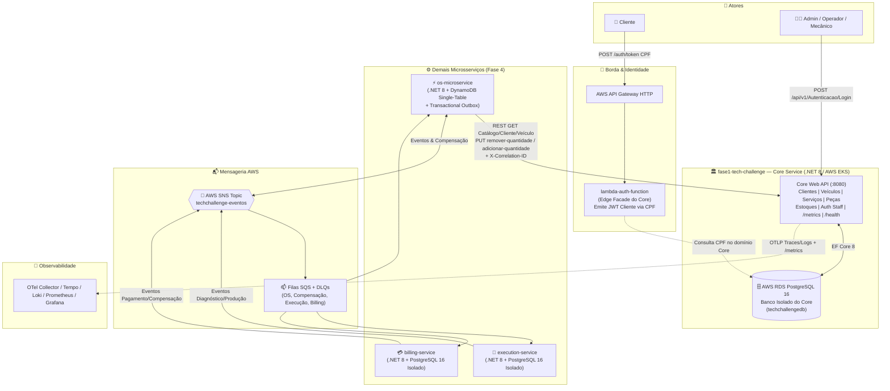
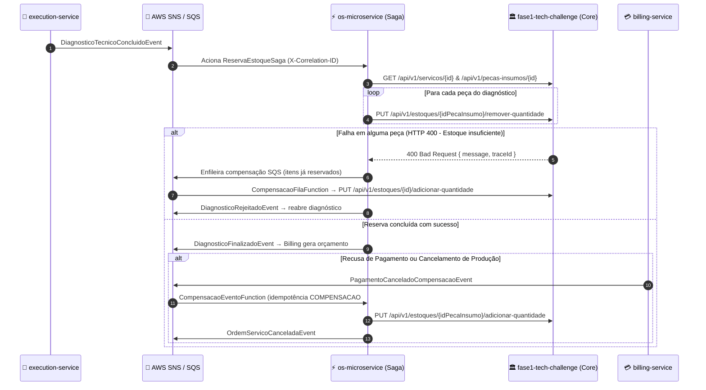

# Tech Challenge — Fase 4 | Core Service (Catálogo, Clientes, Veículos, Estoque & Auth Staff)

Aplicação backend **Core Service** do ecossistema de oficina mecânica do **Tech Challenge — Fase 4**, desenvolvida em **.NET 8 (C# 12)** com **Clean Architecture** e **Domain-Driven Design (DDD)**.

Na **Fase 4**, o antigo monólito da Fase 3 foi decomposto em **4 microsserviços de negócio independentes** com persistência poliglota, mensageria assíncrona (**AWS SNS + SQS com DLQ**) e **Saga Pattern Híbrida**. Este repositório (`fase1-tech-challenge`) concentra exclusivamente o domínio Core:

- **Clientes e Veículos:** cadastro, consulta e validação cadastral (incluindo consulta por CPF/CNPJ).
- **Catálogo de Serviços e Peças/Insumos:** preços unitários, tempos estimados e métricas de tempo de execução.
- **Controle de Estoque:** consulta de saldo, baixa atômica (reserva de peças) e reposição/estorno compensatório acionado pela Saga.
- **Autenticação Staff:** login e cadastro de colaboradores (`Administrador`, `Operador`, `Mecanico`) com emissão de JWT (`Issuer = TechChallenge`, `Audience = techchallenge.com.br`).

> ℹ️ **Visão Consolidada do Ecossistema (Fase 4):**  
> Os domínios de **Ordem de Serviço**, **Diagnóstico Técnico & Produção** e **Orçamento & Pagamento** residem nos microsserviços [`os-microservice`](../os-microservice/README.md), [`execution-service`](../execution-service/README.md) e [`billing-service`](../billing-service/README.md). Contratos compartilhados, suíte BDD E2E e visão consolidada estão centralizados em [`shared`](../shared/README.md) e [`ARQUITETURA_E_VALIDACAO_FASE4.md`](../shared/ARQUITETURA_E_VALIDACAO_FASE4.md).

---

## 🧩 Papel no Ecossistema de Microsserviços (Fase 4)

| Serviço / Repositório | Responsabilidade no Ecossistema | Banco de Dados (Isolado) | Comunicação |
|---|---|---|---|
| 🏛️ **`fase1-tech-challenge`** *(Este repo)* | **Core Service:** Clientes, Veículos, Catálogo (Serviços/Peças), Estoque e Auth Staff | **PostgreSQL 16 (AWS RDS)** (`techchallengedb`) | REST HTTP v1 + Swagger OpenAPI |
| ⚡ [`os-microservice`](../os-microservice/README.md) | **Ordem de Serviço:** ciclo de vida da OS, Saga de reserva/estorno e Transactional Outbox | **Amazon DynamoDB** (Single-Table NoSQL) | REST HTTP + DynamoDB Streams + SNS/SQS |
| 🔧 [`execution-service`](../execution-service/README.md) | **Diagnóstico & Produção:** laudo técnico, fila e execução de tarefas mecânicas | **PostgreSQL 16 Dedicado** (`techchallenge_execution_db`) | REST HTTP + SNS/SQS |
| 💳 [`billing-service`](../billing-service/README.md) | **Orçamento & Pagamento:** geração de orçamento, cobrança Pix/Boleto e webhook Mercado Pago | **PostgreSQL 16 Dedicado** (`techchallenge_billing_db`) | REST HTTP + SNS/SQS + Webhook |
| 🔐 [`lambda-auth-function`](../lambda-auth-function/README.md) | **Edge Facade Serverless (Domínio Core):** valida CPF do cliente e emite JWT de cliente | Lê tabela de clientes do Core RDS | API Gateway HTTP + AWS Lambda |
| 📦 [`shared`](../shared/README.md) | Contratos compartilhados (`Fiap.TechChallenge.Contracts`), `CorrelationContext`, testes BDD E2E e Docker Compose unificado | — | Referência de projeto (`../shared`) |
| ☁️ `soat-infra` & `soat-db` | Infraestrutura como código (VPC, AWS EKS, RDS, API Gateway, SNS/SQS, Prometheus/Grafana/Loki/Tempo) | — | Terraform + Helm |

### Isolamento de Banco de Dados (PostgreSQL 16 RDS)

- Este serviço possui seu próprio banco relacional **PostgreSQL 16** (provisionado em **AWS RDS** na nuvem e via contêiner `postgres:16` no `docker-compose.yml` local), sem chaves estrangeiras cruzadas ou compartilhamento de tabelas com `os-microservice`, `execution-service` ou `billing-service`.
- Nenhum outro microsserviço de negócio acessa o PostgreSQL do Core diretamente: `os-microservice` consulta clientes, veículos, catálogo e executa reserva/estorno de estoque exclusivamente via API REST (`CoreApiClient` com contratos de `Fiap.TechChallenge.Contracts.CoreService`).
- Como decisão formal de fronteira arquitetural, apenas `lambda-auth-function` atua como **Edge Facade Serverless** pertencente ao domínio de identidade do Core para autenticação de clientes por CPF.

---

## 🏗️ Arquitetura do Ecossistema e do Core Service



### Camadas Internas (.NET 8 — Clean Architecture & DDD)

- **`Fiap.TechChallenge.Domain`**: Entidades (`Cliente`, `Veiculo`, `Servico`, `PecaInsumo`, `Estoque`, `Usuario`, `Permissao`), Value Objects, exceções de domínio e interfaces de repositório.
- **`Fiap.TechChallenge.Application`**: Serviços de aplicação (`ClienteService`, `VeiculoService`, `ServicoService`, `PecaInsumoService`, `EstoqueService`, `AutenticacaoService`), DTOs de request/response e mapeamento bidirecional para `Fiap.TechChallenge.Contracts.CoreService`.
- **`Fiap.TechChallenge.Infrastructure`**: `ApplicationDbContext` (Entity Framework Core 8 + Npgsql), configurações de mapeamento, migrations e `DatabaseSeed`.
- **`Fiap.TechChallenge.External`**: Implementação de serviços externos (`TokenService`, `JwtSecretResolver`, `ResendEmailService`, `BCryptCrypto`).
- **`Fiap.TechChallenge.Api`**: Controllers v1, `CorrelationIdMiddleware`, `RequestObservabilityMiddleware`, `ExceptionHandlingMiddleware`, `HealthCheckResponseWriter`, `ObservabilityMetrics` e configuração Swagger/JWT/OpenTelemetry.
- **`../shared/src/Fiap.TechChallenge.Contracts`**: Biblioteca compartilhada referenciada pelos projetos para padronizar rotas (`CoreApiRoutes`), DTOs (`ClienteCatalogoDto`, `ServicoCatalogoDto`, `VeiculoCatalogoDto`, `PecaInsumoCatalogoDto`, etc.), constantes de JWT (`JwtAuthConstants`) e propagação de `X-Correlation-ID` (`CorrelationContext`).

---

## 🔄 Implementação e Justificativa do Saga Pattern

### Justificativa Arquitetural

Com a migração do monólito da Fase 3 para microsserviços independentes e persistência poliglota (**DynamoDB NoSQL** no `os-microservice` e bancos **PostgreSQL 16 isolados** em `fase1-tech-challenge`, `execution-service` e `billing-service`), transações distribuídas bloqueantes baseadas em **Two-Phase Commit (2PC)** introduziriam alto acoplamento temporal, contenção de locks e degradação de disponibilidade.

Para garantir **consistência eventual com recuperação determinística em falhas**, o ecossistema adota uma **Saga Híbrida**:

1. **Etapa Orquestrada (`os-microservice` ↔ Core Service):** ao finalizar o diagnóstico técnico, o `os-microservice` (`ReservaEstoqueSaga`) executa de forma síncrona a validação do catálogo e a reserva atômica das peças no Core Service via HTTP REST. Em caso de falha parcial durante a reserva de múltiplos itens (por exemplo, saldo insuficiente no último item), as baixas já efetivadas são enfileiradas para estorno assíncrono via SQS (`CompensacaoFilaFunction`).
2. **Etapa Coreografada (AWS SNS/SQS entre `os-microservice`, `execution-service` e `billing-service`):** após a reserva de estoque, o fluxo segue por eventos assíncronos no tópico SNS (`techchallenge-eventos-<stage>`) com filas SQS e DLQs dedicadas. Caso o pagamento seja recusado/cancelado (`PagamentoCanceladoCompensacaoEvent`) ou a produção seja cancelada na oficina (`ProducaoCanceladaEvent`), os assinantes (`CompensacaoEventoFunction` no `os-microservice`) cancelam a OS no DynamoDB e acionam o Core para estornar as peças previamente reservadas.

### Papel do Core Service (`fase1-tech-challenge`) na Saga

O Core é o **Source of Truth** do saldo físico/lógico de peças e insumos e provê os endpoints transacionais locais consumidos pelo `os-microservice`:

| Operação na Saga | Endpoint no Core (`EstoqueController`) | Comportamento e Garantias |
|---|---|---|
| **Consulta prévia de saldo** | `GET /api/v1/estoques/quantidade/peca/{idPecaInsumo}` | Retorna a quantidade atual ou `404 Not Found` se não houver estoque cadastrado para a peça. |
| **Reserva / Baixa de estoque** | `PUT /api/v1/estoques/{idPecaInsumo}/remover-quantidade` *(body JSON: `int`)* | Executa `Estoque.RemoverQuantidade(quantidade)` no PostgreSQL. Valida `quantidade > 0` e bloqueia saldo negativo (`InvalidOperationException("Estoque insuficiente.")` → `HTTP 400` via `ExceptionHandlingMiddleware`), disparando o rollback compensatório no orquestrador quando falha. |
| **Compensação / Estorno de estoque** | `PUT /api/v1/estoques/{idPecaInsumo}/adicionar-quantidade` *(body JSON: `int`)* | Executa `Estoque.AdicionarQuantidade(quantidade)` no PostgreSQL para devolver as unidades reservadas quando ocorre falha parcial na reserva, recusa/cancelamento de pagamento ou cancelamento de produção. |

> 🛡️ **Idempotência na Compensação:** A execução idempotente do estorno em entregas repetidas de SNS/SQS é coordenada pelo `os-microservice` mediante chave de controle `COMPENSACAO#{id}` no DynamoDB antes de invocar `PUT /api/v1/estoques/{idPecaInsumo}/adicionar-quantidade` no Core, garantindo que reprocessamentos da fila não dupliquem a reposição de saldo. Todas as requisições carregam `X-Correlation-ID` (`CorrelationIdMiddleware`) para rastreamento distribuído ponta a ponta.



---

## 🔌 Endpoints da API (Core v1)

| Controller | Rota Base | Principais Operações | Autorização |
|---|---|---|---|
| `AutenticacaoController` | `/api/v1/Autenticacao` | `POST /Login`, `POST /Cadastrar` | `Login` anônimo; `Cadastrar` (`Administrador`) |
| `ClienteController` | `/api/v1/clientes` | CRUD + `GET /buscar-por-cpf-cnpj?cpfCnpj=` | `Administrador` (escrita); Staff (leitura); `buscar-por-cpf-cnpj` anônimo |
| `VeiculoController` | `/api/v1/veiculos` | `POST`, `GET` paginado (`PagedRequest`), `GET /{id}`, `PATCH /{id}`, `DELETE /{id}` | `Administrador` (escrita); Staff (leitura) |
| `ServicoController` | `/api/v1/servicos` | CRUD + `GET /metricas-tempo` | `Administrador` (escrita); Staff (leitura); `metricas-tempo` anônimo |
| `PecaInsumoController` | `/api/v1/pecas-insumos` | CRUD + `GET /buscar-por-descricao?descricao=` | `Administrador` (escrita); Staff (leitura) |
| `EstoqueController` | `/api/v1/estoques` | `POST`, `GET /quantidade/peca/{idPecaInsumo}`, `GET /quantidade/descricao`, `PUT /{idPecaInsumo}/remover-quantidade`, `PUT /{idPecaInsumo}/adicionar-quantidade`, `DELETE /{id}` | `Administrador` (escrita/baixa/estorno); Staff (consulta) |
| `PingController` & Probes | `/api/ping`, `/health*`, `/metrics` | `GET /api/ping`, `/health`, `/health/live`, `/health/ready`, `/metrics`, `/swagger` | Anônimo |

### Credenciais Iniciais (DatabaseSeed)

Executado automaticamente no startup (`DatabaseSeed.Apply(db)` em `Program.cs`):

- **Colaboradores (Staff):**
  - `admin@techchallenge.com` / `Admin@123` (Role: `Administrador`)
  - `mecanico@techchallenge.com` / `Mecanico@123` (Role: `Mecanico`)
- **Clientes Seed (para testes com `lambda-auth-function`):**
  - **João Silva:** CPF `282.027.830-20`
  - **Maria Oliveira:** CPF `312.408.510-81`

---

## 🛠️ Stack Tecnológica

| Camada | Tecnologias |
|---|---|
| **Runtime & Framework** | .NET 8 (C# 12), ASP.NET Core Web API, Clean Architecture, DDD |
| **Persistência** | Entity Framework Core 8, PostgreSQL 16 (`Npgsql.EntityFrameworkCore.PostgreSQL`) |
| **Segurança** | JWT Bearer (HMAC-SHA256), BCrypt (`BCrypt.Net-Next`), Roles via `JwtAuthConstants` |
| **Observabilidade** | OpenTelemetry (`OTLP`), Prometheus (`/metrics`), JSON Console Logs, `X-Correlation-ID` |
| **Testes & Qualidade** | xUnit, Moq, FluentAssertions, `Microsoft.AspNetCore.Mvc.Testing`, Testcontainers PostgreSQL, Coverlet, SonarCloud |
| **Containers & K8s** | Docker multi-stage (`shared=../shared`), Docker Compose, Kubernetes (base + overlays local/AWS), HPA (1–5 réplicas) |
| **CI/CD** | GitHub Actions (`ci.yml`, `cd.yaml`, `sonar.yaml`) |

---

## 🚀 Como Executar, Compilar e Fazer Deploy

### Pré-requisitos

- [.NET 8 SDK](https://dotnet.microsoft.com/download) (`8.0.x`)
- [Docker](https://www.docker.com/products/docker-desktop) (necessário também para os testes de integração com Testcontainers PostgreSQL)
- Repositório [`shared`](../shared) clonado no **diretório irmão** (`../shared`), pois os `.csproj` referenciam `../../../shared/src/Fiap.TechChallenge.Contracts/Fiap.TechChallenge.Contracts.csproj`.

> ⚠️ **Nota sobre `.slnx` no .NET 8 SDK:**  
> Este repositório contém `Fiap.TechChallenge.Api.slnx`, cujo formato XML `<Solution>` **não é suportado pelo .NET 8 SDK** (`error MSB4068: The element <Solution> is unrecognized, or not supported in this context`). Por isso, todos os comandos `dotnet restore`, `dotnet build` e `dotnet test` (incluindo nos pipelines `ci.yml` e `cd.yaml`) devem apontar diretamente para os arquivos `.csproj`:
> - `src/Fiap.TechChallenge.Api/Fiap.TechChallenge.Api.csproj`
> - `tests/Fiap.TechChallenge.Tests/Fiap.TechChallenge.Tests.csproj`

### Opção 1: Build e Execução Local via .NET CLI

```bash
# 1. Configurar variáveis de ambiente
cp .env.example .env

# 2. Restaurar dependências dos projetos
dotnet restore src/Fiap.TechChallenge.Api/Fiap.TechChallenge.Api.csproj
dotnet restore tests/Fiap.TechChallenge.Tests/Fiap.TechChallenge.Tests.csproj

# 3. Compilar em Release
dotnet build src/Fiap.TechChallenge.Api/Fiap.TechChallenge.Api.csproj --configuration Release --no-restore

# 4. Executar a API Core (Swagger em http://localhost:8080/swagger)
dotnet run --project src/Fiap.TechChallenge.Api/Fiap.TechChallenge.Api.csproj
```

### Opção 2: Docker Compose (Core API + PostgreSQL 16 + Observabilidade Local)

Sobe `postgres:16`, `api-dev` (montando `../shared:/shared:ro`), `prometheus`, `blackbox-exporter`, `alertmanager`, `loki`, `tempo`, `otel-collector` e `grafana`:

```bash
cp .env.example .env
docker compose up -d
```

- **Swagger UI:** `http://localhost:8080/swagger`
- **Health Checks:** `http://localhost:8080/health`, `/health/live`, `/health/ready`
- **Métricas Prometheus:** `http://localhost:8080/metrics`
- **Grafana:** `http://localhost:3000` (`admin` / `admin`)

### Opção 3: Kubernetes (Local e AWS EKS)

Consulte [`k8s/README.md`](./k8s/README.md) para detalhes de manifestos `base` + `overlays`:

- **Cluster Local (Minikube / Kind):**
  ```bash
  ./k8s/overlays/local/deploy.sh
  ```
- **AWS EKS (Manual ou via `cd.yaml`):**
  ```bash
  aws eks update-kubeconfig --name eks-fiap-soat-terraform --region sa-east-1
  ./k8s/overlays/aws/deploy.sh
  ```
  Quando `k8s/overlays/aws/secrets.yaml` já existir (por exemplo, gerado via `envsubst` no pipeline `.github/workflows/cd.yaml`), o script `deploy.sh` preserva o arquivo existente sem sobrescrevê-lo. Em execuções manuais fora do CI sem `secrets.yaml`, o script obtém as credenciais do AWS SSM Parameter Store / RDS e gera o arquivo a partir de `secrets.yaml.template`.

---

## 🧪 Evidências de Testes e Cobertura de Código (≥ 80%)

A suíte combina testes unitários (Domínio, Value Objects, Aplicação, Controllers, Middlewares e Serviços Externos) e testes de integração/E2E contra PostgreSQL 16 real usando **Testcontainers**.

### Última Execução Verificada (`coverlet.runsettings`)

| Métrica | Resultado Verificado | Meta Fase 4 |
|---|---|:---:|
| **Total de Testes Executados** | **246** | — |
| **Testes Aprovados / Falhas / Ignorados** | **246 aprovados / 0 falhas / 0 ignorados** *(duração: 12 s)* | 100% passando |
| **Cobertura de Linhas (`line-rate`)** | **87.09%** (`0.8709` — **1.856 / 2.131** linhas válidas) | **≥ 80%** ✅ |
| **Cobertura de Branches (`branch-rate`)** | **79.51%** (`0.7951` — **264 / 332** branches válidos) | — |

Os filtros em [`coverlet.runsettings`](./coverlet.runsettings) geram relatórios nos formatos `opencover` e `cobertura`, excluindo apenas projetos de teste (`[*Tests*]*`), o assembly externo de contratos (`[Fiap.TechChallenge.Contracts]*`) e migrations (`**/Migrations/*.cs`).

### Como Reproduzir Localmente

Recomenda-se gravar os artefatos de cobertura fora do repositório (por exemplo, em `/tmp/fase1-test-results`) para manter o diretório de testes limpo:

```bash
dotnet test tests/Fiap.TechChallenge.Tests/Fiap.TechChallenge.Tests.csproj \
  --configuration Release \
  --settings coverlet.runsettings \
  --collect:"XPlat Code Coverage" \
  --results-directory /tmp/fase1-test-results
```

Para gerar o relatório visual HTML com o `reportgenerator` listado em [`dotnet-tools.json`](./dotnet-tools.json):

```bash
dotnet tool restore
dotnet reportgenerator \
  -reports:"/tmp/fase1-test-results/**/coverage.cobertura.xml" \
  -targetdir:"/tmp/fase1-test-results/CoverageReport" \
  -reporttypes:"Html;HtmlSummary"
```

### Qualidade Contínua e Pipelines (CI/CD & SonarCloud)

- **CI (Pull Requests para `main`):** [`.github/workflows/ci.yml`](./.github/workflows/ci.yml) faz checkout multi-repositório (`SOAT-FIAP-2026/shared` para `../shared`), restaura/compila `Fiap.TechChallenge.Tests.csproj`, executa os testes com `coverlet.runsettings` e envia `coverage.opencover.xml` ao SonarCloud (`SOAT-FIAP-2026_fase1-tech-challenge`).
- **SonarQube / SonarCloud (`push` na `main`):** [`.github/workflows/sonar.yaml`](./.github/workflows/sonar.yaml) *(referenciado na documentação do ecossistema junto ao padrão `sonar.yml`)* executa análise estática e publicação de cobertura OpenCover no SonarCloud.
- **CD (`push` em `main` / `feat/infra`):** [`.github/workflows/cd.yaml`](./.github/workflows/cd.yaml) executa `build-and-test`, publica a imagem Docker multi-stage (`shared=../shared`) no Docker Hub e realiza o rollout no cluster AWS EKS via `envsubst` + `k8s/overlays/aws/deploy.sh`.

---

## 📁 Estrutura do Repositório

```text
fase1-tech-challenge/
├── .github/workflows/
│   ├── ci.yml                         # Build, testes, Coverlet e SonarCloud em PRs
│   ├── cd.yaml                         # Build, push Docker Hub e deploy no AWS EKS
│   └── sonar.yaml                      # Análise SonarCloud em push na main
├── docs/                               # Documentação histórica da Fase 3 e Postman
│   ├── adrs/                           # ADR-001 a ADR-003
│   ├── rfcs/                           # RFC-001 a RFC-003
│   └── postman/                        # Collection Postman (techchallenge-api.postman_collection.json)
├── k8s/
│   ├── base/                           # Namespace, Deployment, HPA, Ingress, ConfigMap
│   ├── overlays/local/                 # Manifestos e scripts de deploy local
│   ├── overlays/aws/                   # ConfigMap, Service, secrets.yaml.template e deploy.sh (EKS)
│   ├── metrics-server/                 # Instalação do Metrics Server
│   └── observability/                  # ServiceMonitor, Probe e PrometheusRule
├── observability/                      # Configurações locais (Grafana, Prometheus, Loki, Tempo, OTel, Alertmanager)
├── src/
│   ├── Fiap.TechChallenge.Domain/      # Entidades, VOs, exceções e interfaces de repositório
│   ├── Fiap.TechChallenge.Application/ # Services, DTOs e mapeamentos de contratos
│   ├── Fiap.TechChallenge.Infrastructure/ # EF Core 8, Migrations e DatabaseSeed
│   ├── Fiap.TechChallenge.External/    # JWT, BCrypt e Resend email
│   └── Fiap.TechChallenge.Api/         # Controllers v1, Middlewares, Observability e Program/Startup
├── tests/
│   └── Fiap.TechChallenge.Tests/       # 246 testes unitários e integração (Testcontainers PostgreSQL)
├── coverlet.runsettings                # Configuração Coverlet (OpenCover + Cobertura)
├── Dockerfile                          # Build multi-stage com build-context shared=../shared
├── docker-compose.yml                  # API Core + PostgreSQL 16 + Stack Observabilidade
├── dotnet-tools.json                   # reportgenerator e dotnet-ef
└── README.md                           # Documentação principal (Fase 4)
```

---

## 👥 Autores — Grupo SOAT FIAP

Projeto desenvolvido para a Pós-Graduação em **Software Architecture** da **FIAP** (**Tech Challenge — Fase 4**).
